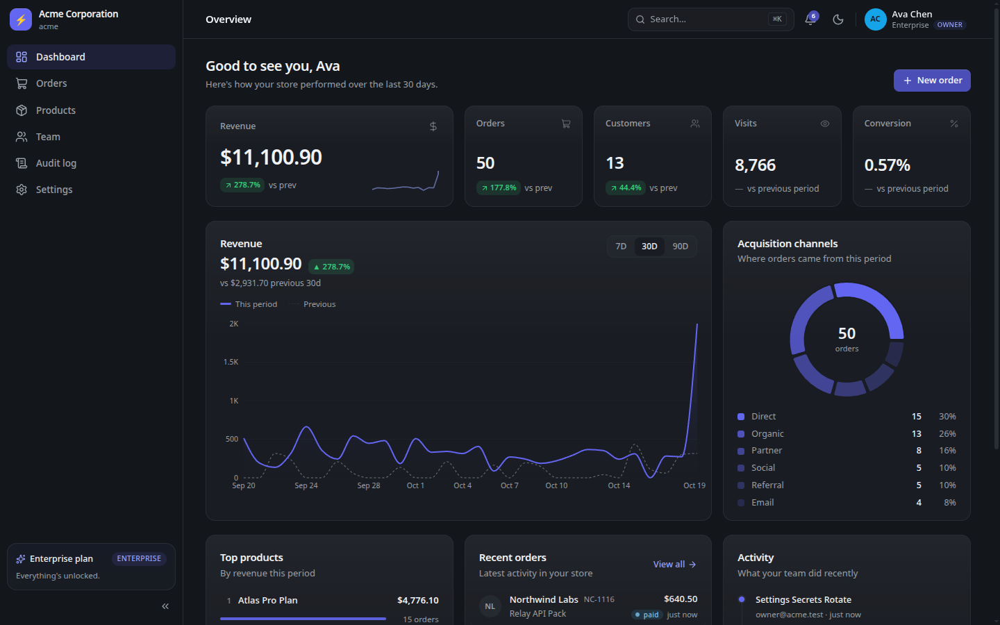
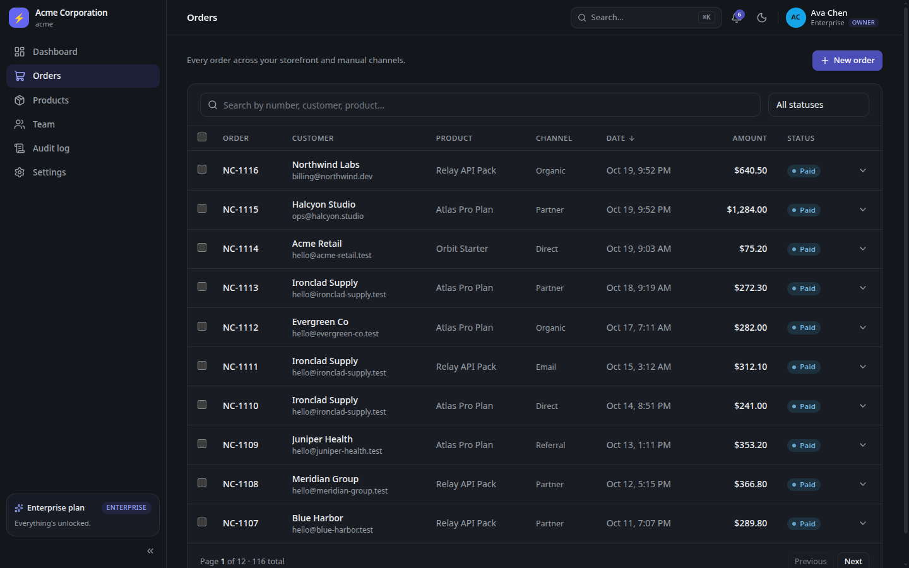
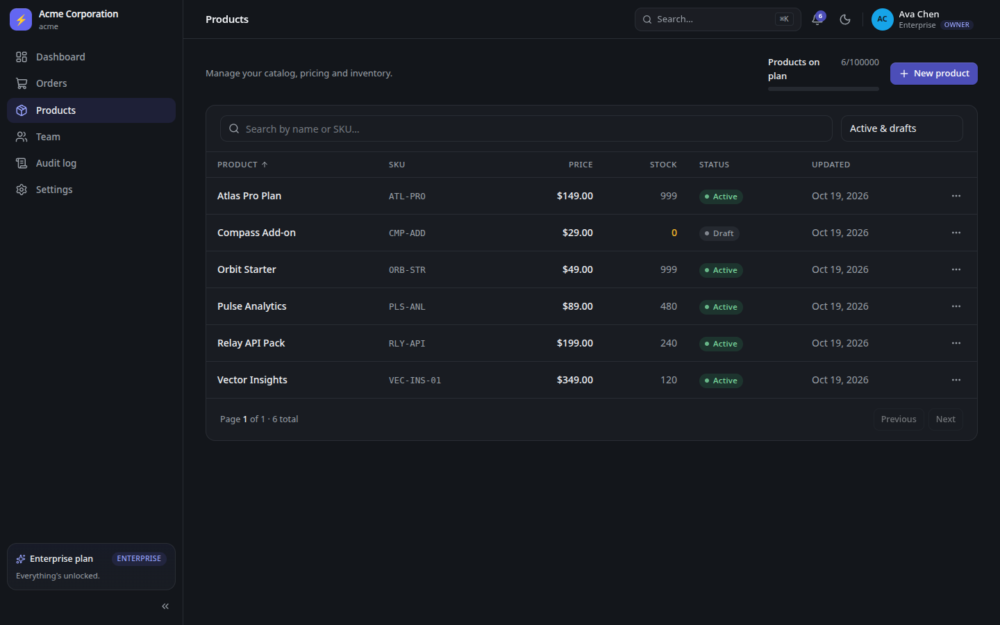
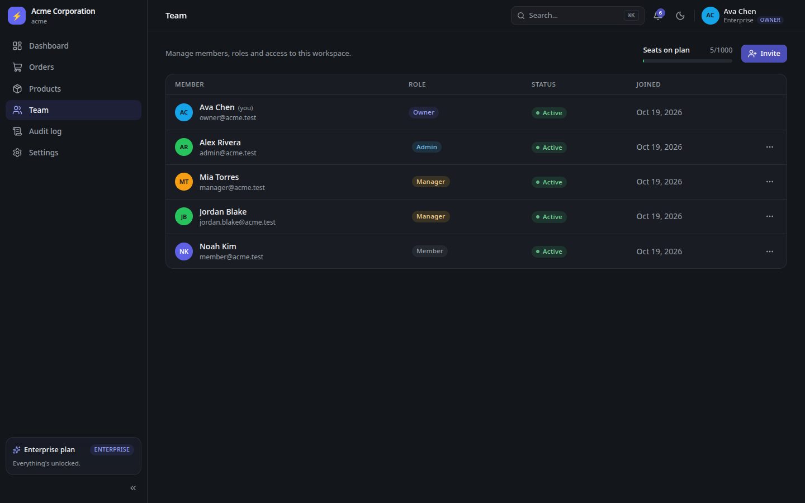
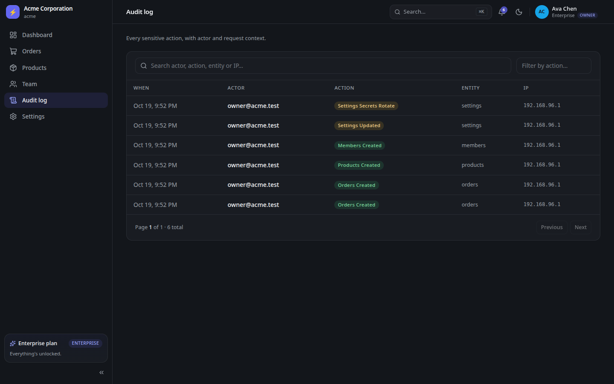
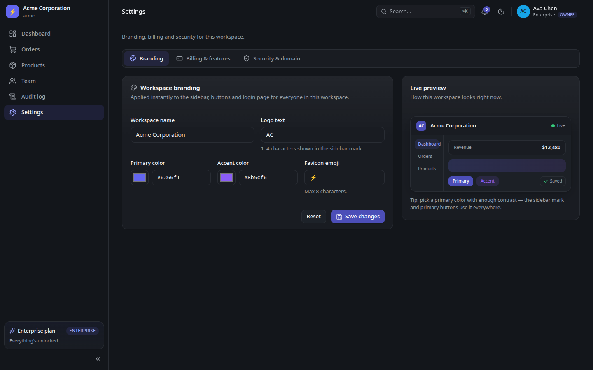
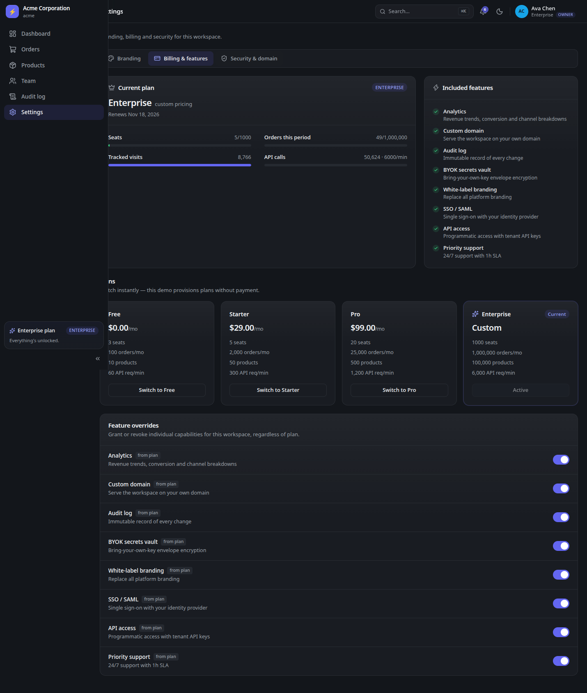
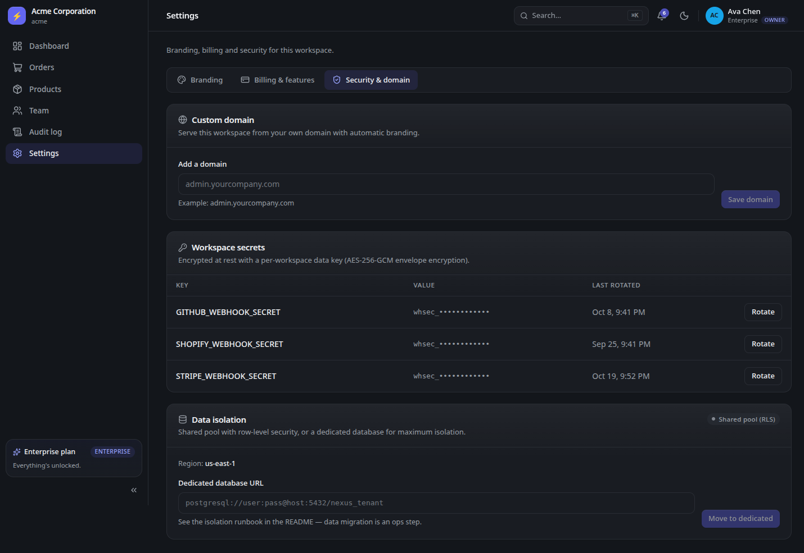
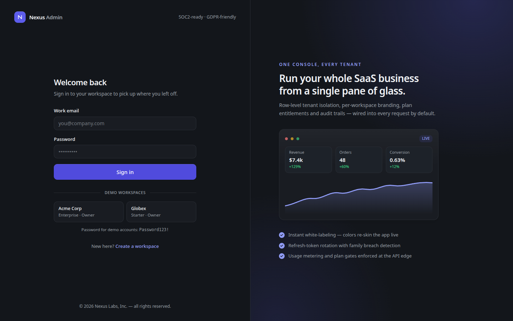

# Nexus Admin

**The multi-tenant admin workspace your customers will actually enjoy using.**

[](#quality--testing)
[](#architecture)
[](#multi-tenancy--security)
[](#quickstart)

<p align="center">
  
</p>
<p align="center"><sub><b>30-second tour</b> — login, analytics, orders, catalogue, team, audit, branding and billing.</sub></p>

## The short version

Nexus Admin is a complete back office for a multi-tenant SaaS product. One polished application serves many customer workspaces, each with its own orders, product catalogue, team, branding, billing and audit trail. Isolation is enforced by PostgreSQL row-level security, so a forgotten filter cannot leak one customer's data into another's. Plans, feature gates, usage meters and a bring-your-own-key secrets vault are included.

It is the admin panel you would otherwise spend months assembling: authentication, roles, tenant context, rate limits, metering, audit, theming and a test suite that actually proves the dangerous parts.

**Live showcase:** [Home](https://m0-ar.github.io/nexus-admin/) · [Quick preview](https://m0-ar.github.io/nexus-admin/preview.html) · [Docs preview](https://m0-ar.github.io/nexus-admin/docs/preview.html)

New to multi-tenant SaaS? Start with the [🌱 Beginner guide](#-beginner-guide--read-this-and-you-are-a-professional).

## Why teams pick it

- **Ship the back office, not the plumbing.** Orders, products, team, billing, audit and settings are already built and connected.
- **Isolation you can demonstrate.** Every tenant table has a forced RLS policy and the runtime database role cannot bypass it.
- **A real commercial model.** Four plans, per-tenant overrides, seat/product/order limits, API rate limits and usage meters.
- **A UI that sells.** Dark-first design, live branding preview, command palette, keyboard support and accessible components.

## Contents

- [What you get](#what-you-get)
- [Screenshots](#screenshots)
- [Who it is for](#who-it-is-for)
- [Quickstart](#quickstart)
- [🌱 Beginner guide — read this and you are a professional](#-beginner-guide--read-this-and-you-are-a-professional)
- [Architecture](#architecture)
- [Multi-tenancy & security](#multi-tenancy--security)
- [Plans & entitlements](#plans--entitlements)
- [API surface](#api-surface-prefix-api)
- [Quality & testing](#quality--testing)
- [Development](#development)
- [Deployment](#deployment)
- [Interactive showcase & GitHub Pages](#interactive-showcase--github-pages)
- [FAQ](#faq)
- [License](#license)

## What you get

### Dashboard analytics

Five KPI cards — revenue, orders, customers, visits and conversion — each with a comparison against the previous period. The revenue chart switches between 7, 30 and 90 days and overlays the previous period for context. Acquisition channels are broken down in a donut chart, alongside top products, recent orders and a live activity feed. Every number is computed inside the current tenant's isolation boundary.

### Orders

A full order ledger with search by order number, customer or product, status filtering, sortable columns and pagination. Create an order with customer, product, channel, amount and status; change status inline; select many rows and apply a bulk status change. Supported statuses are `PENDING`, `PAID`, `REFUNDED`, `CANCELLED` and `FAILED`; channels are `DIRECT`, `ORGANIC`, `REFERRAL`, `SOCIAL`, `PARTNER` and `EMAIL`. Mutations are audited and metered.

### Products

Create, edit, archive and delete catalogue items with name, SKU, price, stock and status (`ACTIVE`, `DRAFT`, `ARCHIVED`). Search and sort the table, watch low-stock counts, and hit the plan's product cap when the workspace outgrows its tier. All counts are tenant-scoped.

### Team & roles

Invite teammates by email with a role, change roles later, or remove access. Seat limits are checked against active and invited memberships, so a plan cannot be oversold. Four roles — `OWNER`, `ADMIN`, `MANAGER`, `MEMBER` — are enforced by API guards and mirrored in the interface: buttons that would fail are not shown.

### Audit log

Every tenant mutation is recorded with actor, action (for example `settings.secrets.rotate`), entity, IP address, user agent and request id. Search the log, filter by action, and use it to answer "who changed this, when, and from where?". Entries are written inside the tenant's RLS context. The dashboard activity feed reads from the same source.

### Workspace branding

Change the workspace name, logo mark (1–4 characters), favicon emoji and primary/accent colours. A live preview shows the result before saving, and because branding is applied as CSS variables, the sidebar, buttons and login page re-skin instantly. Derived shades and foreground colours adapt automatically so custom brands stay legible, and every change is audited.

### Billing & entitlements

See the current plan, renewal date, seats, orders this period, tracked visits and API usage. Compare all four plans and switch instantly in the demo. Below that, toggle per-tenant feature overrides to grant or revoke a capability regardless of plan. Effective entitlements are cached in Redis for 60 seconds and invalidated immediately on change.

### Security & domain

Connect a custom domain and verify it. List workspace secrets as masked values and rotate them; the new plaintext is returned exactly once. Secrets are sealed with AES-256-GCM under a per-tenant data key, which is itself wrapped by a master key. Enterprise owners can request a dedicated database for maximum isolation.

### Notifications

A bell in the top bar tracks unread notifications, with a panel to read them, mark one as read, or mark everything as read. Notifications are tenant-scoped like every other resource.

### Authentication & onboarding

Self-serve signup creates a workspace, an owner account and a 14-day Pro trial. Passwords must be 10+ characters with upper case, lower case and a number. Login includes one-click demo workspace buttons. Access tokens are short-lived; refresh tokens rotate on every use, with family-wide revocation if a burned token is replayed.

### Command palette & workspace switching

Press `⌘K` (or `Ctrl+K`) anywhere to navigate, create an order or product, invite a teammate, toggle the theme, sign out, or switch workspaces when a user belongs to more than one. The account menu exposes the same workspace switcher.

### Theme & accessibility

Dark by default, with a light theme one click away. Components use semantic landmarks, labelled controls, visible focus states and keyboard-navigable dialogs. The interface is checked with axe in the end-to-end suite, and custom brand colours adapt to stay legible.

### Operations

`GET /healthz` for liveness, `GET /readyz` for database and Redis readiness, and `GET /metrics` for Prometheus. Logs carry request id, tenant id and user id through an async-local context, so one request can be followed across services.

### Consistent API errors

Every failure responds with the same shape:

```json
{ "statusCode": 403, "error": "Forbidden", "message": "…", "code": "FEATURE_NOT_ENABLED", "details": {}, "requestId": "…" }
```

Codes such as `SEAT_LIMIT_REACHED`, `PLAN_LIMIT_REACHED`, `FEATURE_NOT_ENABLED` and `RATE_LIMITED` let the frontend show a precise upgrade or retry path instead of a generic error.

## Screenshots

| Dashboard | Orders |
|---|---|
|  |  |

| Products | Team |
|---|---|
|  |  |

| Audit log | Branding |
|---|---|
|  |  |

| Billing & features | Security & domain |
|---|---|
|  |  |

<p align="center">
  
</p>

## Who it is for

| You are | You get |
|---|---|
| A founder or small product team | A customer-facing back office you can launch now, with a pricing model already wired in. |
| A product or operations lead | Clear screens for orders, catalogue, team access and audit, without waiting on an engineering backlog. |
| An engineer | A reference implementation of RLS, tenant context, entitlements, refresh rotation, BYOK encryption and metering. |
| An agency | A white-label-ready base you can rebrand per client and deploy repeatedly. |
| A learner or interviewer | A realistic, runnable system that makes multi-tenant security concrete instead of theoretical. |

## Quickstart

```bash
cp .env.example .env
docker compose up --build -d
open http://localhost:3000
```

That is the whole setup. The first boot applies migrations and seeds two demo workspaces. The sample values in `.env.example` are fine for local use; replace every `CHANGE_ME` before deploying anywhere public (see [Deployment](#deployment)).

- Frontend: <http://localhost:3000>
- API: <http://localhost:4000/api>
- Health: <http://localhost:4000/api/healthz>

Port 3000 already taken?

```bash
FRONTEND_PORT=3200 \
FRONTEND_ORIGIN=http://localhost:3200,http://localhost:3000 \
docker compose up --build -d
```

`FRONTEND_ORIGIN` is a comma-separated allowlist, so both origins remain valid.

### Demo accounts — password `Password123!`

| Workspace | Plan | Email | Role |
|---|---|---|---|
| Acme Corporation | ENTERPRISE | `owner@acme.test` | OWNER |
| Acme Corporation | ENTERPRISE | `admin@acme.test` | ADMIN |
| Acme Corporation | ENTERPRISE | `manager@acme.test` | MANAGER |
| Acme Corporation | ENTERPRISE | `member@acme.test` | MEMBER |
| Globex Industries | STARTER | `owner@globex.test` | OWNER |
| Globex Industries | STARTER | `admin@globex.test` | ADMIN |

The login page has one-click buttons for both workspaces. Globex ships with a per-tenant **feature override** (`audit_log: true`) so you can see a capability granted outside its plan: its audit page works, while its secrets vault shows the Enterprise upgrade gate.

## 🌱 Beginner guide — read this and you are a professional

New to terms like tenant, entitlement, RLS or refresh-token rotation? Read this section once. You will know more than most interview candidates.

Let's work this out in a step-by-step way to be sure we have the right answer

### 1. Start the system

```bash
cp .env.example .env
docker compose up --build -d
```

Four containers start: PostgreSQL stores the data, Redis stores counters and cached entitlements, the NestJS API enforces the rules, and the Next.js app renders the interface. Wait for `healthy`, then open <http://localhost:3000>.

### 2. Sign in without typing a password

Click **Acme Corp — Enterprise · Owner**. The browser receives a short-lived access token and a rotating refresh cookie. The app uses the access token for API calls; the cookie lets it obtain a new one later without asking you to sign in again.

### 3. Read the dashboard like an operator

Revenue is the sum of paid orders in the selected window. The small percentages compare this period with the previous one. The chart shows the current period as a solid line and the previous period as a dashed line. The donut answers "where did orders come from?" — direct, organic, referral, social, partner or email.

### 4. Create an order and watch three things happen

Go to **Orders → New order**, fill in a customer and amount, and save. The order appears in the table, the dashboard totals move, and a new row appears in **Audit log** and the activity feed. That is not three separate features: one mutation triggers metering, auditing and cache-aware reads.

### 5. See a plan gate

Sign out and sign in as `owner@globex.test` (Starter). The audit page still works because Globex has an explicit override; the secrets vault explains that BYOK is an Enterprise capability. Sign back in as Acme to compare. This is how the product sells upgrades without hiding the rest of the app.

### 6. Change the brand

Open **Settings → Branding**, change the primary colour, and watch the live preview. Save, then look at the sidebar and buttons. When the workspace is served from a custom domain, the login screen picks up the same branding automatically.

### 7. Invite a teammate

Go to **Team → Invite**, choose a role and send. The member appears as invited, and the seat counter increases. If the plan has no seats left, the API returns `SEAT_LIMIT_REACHED` and the UI offers the upgrade path. Role changes are audited.

### 8. Investigate with the audit log

Open **Audit log** and search for `settings` or `orders`. Each row tells you who did what, to which entity, when, and from which IP. This is the same data the activity feed uses, scoped to the current tenant.

### 9. Call the API yourself

```bash
TOKEN=$(curl -s -X POST http://localhost:4000/api/auth/login \
  -H 'content-type: application/json' \
  -d '{"email":"owner@acme.test","password":"Password123!"}' | jq -r .accessToken)

curl -s http://localhost:4000/api/orders \
  -H "authorization: Bearer $TOKEN" | jq '.items[0]'
```

The JWT contains a tenant id (`tid`). The API opens a tenant context for the request, sets it on the database connection, and PostgreSQL's policies filter every row. Remove the header and you get `401`; use another tenant's token and you still see only that tenant's data.

### 10. Read the four files that matter

- `backend/src/billing/plans.ts` — the commercial model in one place.
- `backend/prisma/migrations/` — RLS policies and grants.
- `backend/src/billing/entitlements.service.ts` — plan + override resolution.
- `backend/src/common/interceptors/audit.interceptor.ts` — how every mutation becomes an audit row.

### The ideas, in plain English

| Term | What it means here |
|---|---|
| **Tenant** | One customer company. Its data is isolated from every other company. |
| **Workspace** | The user-facing name for a tenant. Acme and Globex are two workspaces. |
| **Multi-tenant** | One running application serves many customers without mixing their data. |
| **Row-level security (RLS)** | A database rule that hides rows belonging to other tenants, even if the query forgets to filter. |
| **JWT** | A signed token that tells the API who you are and which tenant you belong to. |
| **Refresh token** | A longer-lived cookie used to get a new access token. It rotates on every use. |
| **RBAC** | Role-based access control: owner, admin, manager and member each get different powers. |
| **Entitlement** | A feature or limit a plan grants, such as "audit log" or "1,000 seats". |
| **Override** | A per-tenant exception that adds or removes an entitlement. |
| **Metering** | Counting usage (orders, visits, API calls) so limits and invoices can be calculated. |
| **Audit log** | An append-only record of sensitive actions, with actor and context. |
| **BYOK** | Bring your own key: the customer's secrets are encrypted under keys the platform can rotate. |
| **Envelope encryption** | A master key protects a per-tenant data key; the data key encrypts the actual secrets. |
| **Rate limit** | A cap on requests per minute so one tenant cannot exhaust shared capacity. |
| **Seed** | Sample data inserted on first boot so the app is useful immediately. |
| **Migration** | A versioned database change, applied automatically at startup. |
| **Docker Compose** | A single file that starts the database, cache, API and web app together. |

### What happens on one request

1. The browser calls the API with an access token.
2. A guard verifies the signature and extracts user and tenant ids.
3. A context interceptor stores `{ requestId, tenantId, userId }` for the life of the request.
4. Role and feature guards check whether this user may perform this action on this plan.
5. The rate limiter counts the request against the tenant's per-minute budget.
6. The database connection sets the tenant id; RLS policies filter every row.
7. The mutation is written, then metering and audit records are appended inside the same tenant context.
8. The response returns with a request id; logs, metrics and audit rows can all be correlated.

## Architecture

```
┌─────────────┐    ┌──────────────────────────────┐    ┌──────────────────┐
│  Next.js 16 │───▶│  NestJS 12 (Fastify)         │───▶│  PostgreSQL 17   │
│  React 19   │    │  • JWT auth + refresh chains │    │  RLS FORCE on    │
│  Tailwind 4 │    │  • tenant context (ALS)      │    │  8 tenant tables │
│  Recharts   │    │  • entitlements + overrides  │    │  app_user is     │
└─────────────┘    │  • audit + usage + metrics   │    │  NOBYPASSRLS     │
                   └──────────────┬───────────────┘    └──────────────────┘
                                  │ Redis 7 (entitlements cache, rate limit
                                  │ counters, usage meters)
```

Two database roles matter. `nexus_owner` runs migrations and seeds. `app_user` is the runtime role: it has `NOBYPASSRLS`, so the policies apply to it even if a query is written carelessly. Control-plane tables (tenants, users, subscriptions, refresh tokens) sit outside RLS and are always filtered explicitly.

## Multi-tenancy & security

1. **Shared schema + forced RLS.** Eight tenant tables (`orders`, `products`, `notifications`, `audit_logs`, `usage_records`, `integration_secrets`, `tenant_keys`, `feature_overrides`) carry a `tenant_isolation` policy comparing `tenant_id` with `current_setting('app.tenant_id')`. Missing context returns zero rows, not another tenant's rows.
2. **Request-scoped tenant context.** The JWT carries `tid`; an interceptor binds `{ requestId, tenantId, userId }` in `AsyncLocalStorage`, so logging and auditing do not need the values threaded through every function call.
3. **Per-tenant branding.** Name, logo mark, favicon emoji and colours live on the tenant row and become runtime CSS variables. The sidebar, buttons and login page re-skin together; every change is audited.
4. **Plan entitlements + overrides.** `EntitlementsService` resolves the effective feature set on each request, cached in Redis for 60 seconds and invalidated immediately when a plan or override changes. `@RequireFeature` and `@Roles` make enforcement declarative.
5. **Seat and usage metering.** Invitations check active plus invited memberships. Monthly orders, product counts, visits and API calls are written to `usage_records` and surfaced in the billing tab.
6. **Per-tenant rate limiting.** The plan's requests-per-minute is enforced with Redis fixed-window counters plus a per-second burst budget. Over-limit calls receive `429 RATE_LIMITED` with `retryAfterSeconds`; auth routes add a separate per-IP limiter.
7. **Refresh rotation with breach detection.** Access tokens are 15-minute JWTs held in memory. Refresh tokens are 30-day httpOnly cookies, hashed at rest and rotated on every use; replaying a burned token revokes the entire family. Passwords are argon2id.
8. **BYOK envelope encryption.** A master key wraps a per-tenant data key (`tenant_keys.wrapped_dek`); integration secrets are sealed with AES-256-GCM under that key. The API returns masked values only, and rotation reveals the new plaintext exactly once.
9. **Isolation upgrade path.** Tenants start on the shared RLS pool. An Enterprise owner can request a dedicated database, after which the registry routes that tenant to its own connection. Region pinning (`dataRegion` + `ENFORCE_REGION`) rejects requests served by the wrong regional stack.
10. **Audit trail.** Every tenant mutation records actor, action, entity, IP, user agent and request id inside the tenant's context. The dashboard feed and audit page read the same append-only source.

## Plans & entitlements

Defined once in `backend/src/billing/plans.ts` and enforced at the API edge.

| | FREE | STARTER | PRO | ENTERPRISE |
|---|---|---|---|---|
| Price | $0 | $29/mo | $99/mo | custom |
| Seats | 3 | 5 | 20 | 1,000 |
| Orders/mo | 100 | 2,000 | 25,000 | 1,000,000 |
| Products | 10 | 50 | 500 | 100,000 |
| API req/min | 60 | 300 | 1,200 | 6,000 |
| Analytics | — | ✓ | ✓ | ✓ |
| Custom domain | — | — | ✓ | ✓ |
| Audit log | — | — | ✓ | ✓ |
| BYOK vault | — | — | — | ✓ |
| White-label | — | — | — | ✓ |
| SSO / SAML | — | — | — | ✓ |
| API access | — | ✓ | ✓ | ✓ |
| Priority support | — | — | — | ✓ |

Effective entitlements are the plan's features plus or minus per-tenant overrides. Seats, product counts and request rates are enforced at the edge; monthly orders and tracked visits are metered and shown in billing. The demo switches plans without payment — connect your billing provider where `POST /billing/plan` is handled.

## API surface (prefix `/api`)

| Area | Endpoints |
|---|---|
| Auth | `POST /auth/signup`, `/auth/login`, `/auth/refresh`, `/auth/logout`, `/auth/switch`, `GET /auth/me` |
| Tenants | `GET /public/tenants/resolve`, `GET /public/tenants/:slug`, `GET /tenants/me`, `POST /tenants/me/isolation` |
| Billing | `GET /billing`, `POST /billing/plan`, `POST /billing/features` |
| Orders | `GET /orders`, `POST /orders`, `PATCH /orders/:id/status`, `PATCH /orders/bulk/status` |
| Products | `GET /products`, `POST /products`, `PATCH /products/:id`, `DELETE /products/:id` |
| Members | `GET /members`, `POST /members/invite`, `PATCH /members/:id`, `DELETE /members/:id` |
| Settings | `GET/PATCH /settings/branding`, `POST /settings/domain`, `POST /settings/domain/verify`, `GET /settings/secrets`, `POST /settings/secrets/rotate` |
| Audit | `GET /audit` |
| Dashboard | `GET /dashboard/summary` |
| Notifications | `GET /notifications`, `PATCH /notifications/:id/read`, `POST /notifications/read-all` |
| Ops | `GET /healthz`, `GET /readyz`, `GET /metrics` (Prometheus) |

### Role matrix (checked by guards, mirrored by the UI)

| Capability | OWNER | ADMIN | MANAGER | MEMBER |
|---|---|---|---|---|
| Orders (create/update) | ✓ | ✓ | ✓ | ✓ |
| Products (create/update/delete) | ✓ | ✓ | ✓ | — |
| Invite / edit / remove members | ✓ | ✓ | — | — |
| Branding, custom domain | ✓ | ✓ | — | — |
| Change plan | ✓ | — | — | — |
| Feature overrides | ✓ | ✓ | — | — |
| Secrets (list / rotate) | ✓ / ✓ | ✓ / — | — | — |
| Audit log | ✓ | ✓ | ✓ | ✓ |
| Isolation switch | ✓ + ENTERPRISE | — | — | — |

## Quality & testing

| Layer | What it proves | Result |
|---|---|---|
| Backend (Vitest) | Auth, tenancy, entitlements, rate limits, encryption, audit | **42 passing** |
| Frontend (Vitest) | Components, hooks, formatting, error handling | **37 passing** |
| End-to-end (Playwright) | API contracts, real browser flows, accessibility (axe), visual regression | **62 passing** |
| Load (k6) | Smoke profile against the live stack | **673 requests, 0 failures, p95 27.6 ms** |

```bash
(cd backend && npm test)
(cd frontend && npm test)
(cd e2e && E2E_UI_URL=http://localhost:3000 npx playwright test)
docker run --rm --network host -v "$PWD/load:/scripts:ro" grafana/k6 run /scripts/smoke.js
```

The end-to-end suite expects the Docker stack to be running. It signs in through the real API, exercises role and plan gates, checks pages with axe, and compares key screens against committed visual baselines. CI runs backend, frontend and end-to-end jobs on every push.

## Development

Everything is containerized, but both apps run natively for hot reload:

```bash
make up            # build + start the whole stack
make logs          # tail everything
make reset         # nuke volumes, rebuild (destroys data)
make seed          # re-run the idempotent demo seed
make psql          # psql as nexus_owner
make redis-cli     # redis shell
make backend-dev   # NestJS with tsx watch (needs docker postgres+redis)
make frontend-dev  # Next.js dev server
make migrate       # create a new Prisma migration locally
make build         # type-check + build both apps locally
```

### Layout

```
backend/
  prisma/               schema, migrations (RLS policies + grants), initdb
  src/
    auth/               login, refresh rotation, argon2id, guards
    tenancy/            tenant context, registry, isolation
    billing/            plans, entitlements (Redis-cached), usage
    resources/          orders, products, members, settings, audit, dashboard
    common/             interceptors (context, audit, usage, metrics), zod pipes
    crypto/             envelope encryption (MASTER_KEY → DEK → AES-GCM)
    metrics/            /metrics, /healthz, /readyz
frontend/
  src/app/(app)/        dashboard, orders, products, users, audit, settings
  src/app/login         themed login with demo workspace shortcuts
  src/components/       shell, command palette, tables, forms, charts
  src/lib/              api client, auth store, hooks, formatters
e2e/
  tests/api/            API contract checks
  tests/ui/             browser flows, accessibility and visual regression
load/
  smoke.js              k6 smoke profile
docs/
  index.html            interactive showcase (GitHub Pages)
  assets/               screenshots, demo GIF, social preview
```

## Deployment

- [ ] Replace every `CHANGE_ME` — database passwords, `JWT_SECRET` (`openssl rand -hex 32`), `MASTER_KEY` (64 hex characters).
- [ ] Set `COOKIE_SECURE=true` and `COOKIE_DOMAIN=.yourdomain.com` behind TLS.
- [ ] Set `SEED_DEMO_DATA=false` for real deployments.
- [ ] Put the stack behind a TLS-terminating proxy; the API trusts forwarded headers for audit-log IP capture.
- [ ] Back up PostgreSQL and store `MASTER_KEY` separately — losing it makes stored secrets unrecoverable.
- [ ] For regions: deploy one stack per region, set `APP_REGION`, enable `ENFORCE_REGION=true`, and point geo-DNS at each stack.
- [ ] For a dedicated database: provision it, run `prisma migrate deploy` against it, then `POST /api/tenants/me/isolation` with `{ "mode": "DEDICATED", "dedicatedDatabaseUrl": "…" }`.

## Interactive showcase & GitHub Pages

`docs/index.html` is the canonical standalone, interactive tour of the product: feature explorer, architecture walkthrough, pricing, screenshots and a short quiz that takes a newcomer from zero to confident. It uses no external libraries and works offline.

**Live pages** (published from `main` / repository root):

| Route | Open in browser | What it is |
|---|---|---|
| `/` | [m0-ar.github.io/nexus-admin/](https://m0-ar.github.io/nexus-admin/) | Showcase home |
| `/preview.html` | [m0-ar.github.io/nexus-admin/preview.html](https://m0-ar.github.io/nexus-admin/preview.html) | Root mirror of the showcase |
| `/docs/preview.html` | [m0-ar.github.io/nexus-admin/docs/preview.html](https://m0-ar.github.io/nexus-admin/docs/preview.html) | Docs-folder mirror |

All three routes render the same showcase. Root `index.html` redirects to `/preview.html`, and `docs/preview.html` redirects to the canonical docs page. `.nojekyll` is present at both the repository root and in `docs/` so the files are served exactly as written.

To publish:

1. Push the repository to GitHub.
2. Open **Settings → Pages**.
3. Under **Build and deployment**, choose **Deploy from a branch**.
4. Select branch `main` and folder **`/ (root)`**, then save. The root source is required for all three URLs above; switching to `/docs` removes the `/docs/preview.html` route.
5. Open `https://m0-ar.github.io/nexus-admin/`.

For a richer link preview, upload `docs/assets/social-preview.png` (1280×640, under 1 MB) in **Settings → Social preview**.

## FAQ

**Is this production-ready?**
It is production-minded: migrations, RLS, hashed refresh tokens, encryption, rate limits and tests are real. Treat it as a strong foundation and complete the [deployment checklist](#deployment) before handling customer data.

**Do I need Stripe?**
No. Plan changes are instant in the demo. When you are ready to charge, replace the handler behind `POST /billing/plan` with your provider's checkout and webhooks; entitlements already react to plan changes.

**How do you prove tenant isolation?**
The runtime role cannot bypass RLS, policies compare every row to the request's tenant id, and the end-to-end suite logs in as different tenants and confirms they cannot see each other's orders, products, audit rows or secrets. Try it yourself with two logins.

**Can each customer use their own domain?**
Yes. The settings security tab saves and verifies a custom domain for the workspace, with automatic branding.

**Can a tenant move to a dedicated database?**
Yes, as an operations step. Provision the database, apply migrations, then call the isolation endpoint. The tenant registry re-routes subsequent requests.

**Does a user belong to only one workspace?**
The data model supports multiple memberships per user and `/auth/switch`. The demo seeds one membership per user to keep the story simple.

**What is not included?**
Payment processing, email delivery and an actual SSO/SAML provider integration. The plans and entitlement flags for those capabilities are present so you can connect your provider without reshaping the product.

## License

Demo/portfolio code — no license granted unless agreed in writing.
